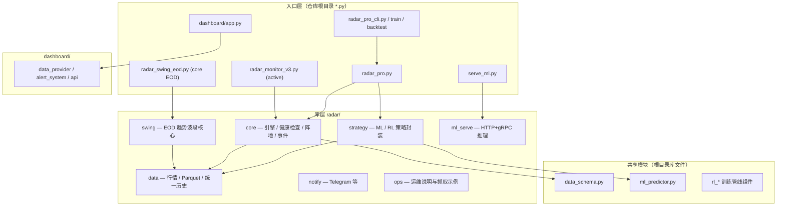

# Trading Radar — 架构说明

本文描述仓库的分层边界、推荐入口与附属脚本，便于新人定位代码与扩展功能。

---

## 分层总览

**已知历史包袱（已处理）**：曾存在 `radar/strategy.py` 与 `radar/strategy/` 包、`radar/utils.py` 与 `radar/utils/` 包同名遮蔽，导致 `TechnicalAnalyzer`、`setup_logging` 等导入失败；现已并入子包（见 `radar/strategy/technical_analyzer.py`、`radar/utils/__init__.py`）。旧版根目录 `radar.py` 现在仅作为兼容包装转发到 `radar_monitor_v3.py`。V1/V2 主入口（`radar_monitor.py` / `radar_monitor_v2.py`）已归档至 [`legacy/`](legacy/)。

**约定**

| 层级 | 职责 |
|------|------|
| **入口层** | `if __name__`、CLI 解析、组装配置；应尽量薄，复杂逻辑放在 `radar/`。 |
| **库层 `radar/`** | 可测试的业务与基础设施；被入口与测试导入。 |
| **`dashboard/`** | Web UI 与 REST API；依赖 `radar` 共性模块时需避免循环导入（优先通过接口或顶层模块）。 |
| **根目录共享脚本** | 历史演进遗留：`ml_training.py`、`rl_*.py`、`backtest_pro.py` 等与训练/回测强相关；新代码优先放进 `radar/trainer/`、`radar/strategy/` 并在入口调用。 |

---

## 推荐入口（优先阅读 / 运维）

| 场景 | 命令 | 说明 |
|------|------|------|
| 趋势波段 EOD 核心 | `python radar_swing_eod.py --config config.swing.json` | 每日 15:10 收盘后机械决策；10 只 ETF；周线 MACD 金叉 / 放量突破 MA60 / 情绪 5%/95% 极值。 |
| 生产监控 | `python radar_monitor_v3.py` | V3 active；自适应扫描 / 告警去重 / 健康端点 8080。 |
| Pro 实时监控 | `python radar_pro_cli.py` | 委托 `radar_pro.entry_monitor`。 |
| ML / RL 训练 | `python radar_pro_train.py` | 替代直接长跑 `radar_pro.py --train`。 |
| 回测 | `python radar_pro_backtest.py` | 同上。 |
| Dashboard | `python dashboard/app.py` | HTTP API 见 `dashboard/api/`。 |
| ML 推理进程 | `python serve_ml.py` | 可选与监控分离部署。 |

**兼容聚合入口**：`radar_pro.py` 仍保留 `--train`、`--backtest` 等子命令，便于旧脚本与文档；新建自动化请改用上表拆分脚本。

---

## 根目录 Python 脚本归类

以下为「为何躺在根目录」的说明，**不等于都推荐直接使用**。

### 第一类：门面入口（优先）

- `radar_swing_eod.py`（**core** 趋势波段 EOD；配置源 `config.swing.json`；systemd 15:10 调度）
- `radar_monitor_v3.py`（**active** 生产监控）、`radar_pro_cli.py`、`radar_pro_train.py`、`radar_pro_backtest.py`、`radar_pro.py`
- `serve_ml.py`
- 历史 V1/V2 主入口已归档至 [`legacy/`](legacy/)

### 第二类：领域库（被入口或 `radar/` 引用）

- `data_schema.py` — 数据契约；新代码使用 `radar.schemas.data_schema`
- `ml_predictor.py`、`ml_training.py` — ML 推理与训练管线；新代码使用 `radar.ml.predictor`
- `backtest_engine.py`、`backtest_pro.py` — 回测引擎；新代码使用 `radar.backtest.engine`
- `mx_client.py`、`mx_quota.py` — 外部「妙想」等接口与配额

### 第三类：RL / 实验脚本（训练调参）

- `rl_agent.py`、`rl_environment.py`、`rl_features.py`、`rl_strategy.py`
- `train_*.py`、`retrain_base_models.py`、`run_backtest_comparison.py`、`run_benchmark.py`

### 第四类：旧版或极简别名

- `radar.py`、`radar_trainer.py`、`monitor.py` — 保留兼容；`radar.py` 转发到 `radar_monitor_v3.py`，新代码勿再依赖旧版经典 `RadarEngine` 行为。

扩展新功能时：**核心业务进 `radar/<area>/`**，仅在需要独立进程边界时再增加根目录入口脚本。

---

## `radar/` 包内导航

| 目录 | 内容 |
|------|------|
| `radar/core/` | `MonitorEngine`、轮询/事件模式 mixin、健康 HTTP、`battlefield_state`、告警编排、Prometheus 扩展 |
| `radar/data/` | 行情拉取、并发规范化、Parquet、MX feature cache、`unified_history` |
| `radar/strategy/` | ML / RL 策略与特征抽取 |
| `radar/ml/` | ML 预测器包内路径（根目录旧模块仍兼容） |
| `radar/backtest/` | 回测引擎包内路径（根目录旧模块仍兼容） |
| `radar/notify/` | Telegram 等通道 |
| `radar/ml_serve/` | gRPC / HTTP 推理服务实现 |
| `radar/swing/` | **趋势波段 EOD 核心**：宏观情绪切片、SQLite store、周线 MACD、放量突破 MA60、事实通知 |
| `radar/schemas/`、`radar/config_schema.py` | JSON / 运行时校验 |
| `radar/ops/` | 运维文档与 Prometheus 示例 |

---

## 配置与密钥

- 运行时：`config.swing.json`（趋势波段 EOD 核心配置）、`config.json`（监控主配置），schema 均在 `radar/config_schema.py`。
- 模型清单：`models/manifest.json`（`RADAR_MODEL_MANIFEST`）。
- 密钥不落库：`.gitignore` 已排除 `.env`、本地 DB 与缓存路径。

---

## 相关文档

- 数据管道：`radar/data/PIPELINE.txt`
- Schema 详解：`DATA_SCHEMA_GUIDE.md`
- 推送与观测：`radar/ops/PUSH_AND_OBSERVABILITY.txt`
