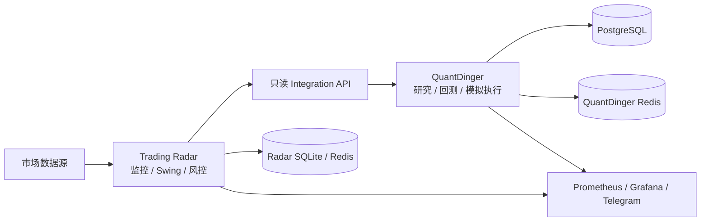

# Trading Radar Quant Platform

面向个人量化研究与生产运维的一体化平台。仓库将 **Trading Radar** 的行情监控、风险过滤与审计能力，和定制版 **QuantDinger** 的策略研究、回测、模拟执行能力合并到同一套代码、文档与 Docker Compose 编排中。

> 默认面向研究与模拟环境。实盘交易开关保持关闭；任何启用实盘的改动都必须单独评审、验证并留有回滚方案。本项目不构成投资建议。

## 能力概览

| 模块 | 主要职责 | 目录 / 服务 |
|---|---|---|
| Radar Swing | A 股趋势波段 EOD 决策、证据链、结果评估 | `radar/swing/`、`radar_swing_eod.py` |
| Radar Monitor | 实时行情、数据源降级、告警与可观测性 | `radar/`、`radar_monitor_v3.py` |
| Radar Integration API | 向 QuantDinger 提供只读市场上下文 | `dashboard/integration_app.py`、`integration-api` |
| QuantDinger | 策略源码、指标研究、回测、模拟盘与交易基础设施 | `QuantDinger/` |
| Personal Research Radar | 组合个人 A 股观察名单、AI/指标研究、策略与已保存回测的 Telegram 只读报告 | `scripts/quantdinger_research_radar.py`、`docs/QUANTDINGER_RESEARCH_RADAR.md` |
| Unified Ops | PostgreSQL/Redis、Prometheus/Grafana、备份与回滚 | `docker-compose*.yml`、`deploy/`、`scripts/` |

## 架构



两套业务状态保持隔离：Radar 继续使用自己的 SQLite/Redis，QuantDinger 使用独立 PostgreSQL/Redis；二者只通过带服务令牌的内部只读 API 交换市场上下文。

## 仓库结构

```text
.
├── QuantDinger/                       # 定制版 QuantDinger 源码（Apache-2.0）
├── radar/                             # Radar 核心包
├── dashboard/                         # Dashboard 与 Integration API
├── deploy/                            # systemd、Prometheus、Grafana 与迁移资料
├── scripts/                           # 备份、冒烟、切换、回滚和维护脚本
├── docker-compose.yml                 # Radar 基础编排
├── docker-compose.integration.override.yml
├── docker-compose.quantdinger.yml     # QuantDinger 编排
├── docker-compose.runtime-cleanup.yml
├── radar_swing_eod.py                 # Swing EOD 生产入口
└── radar_monitor_v3.py                # 实时监控入口
```

QuantDinger 的上游来源、固定版本和许可证说明见 [`THIRD_PARTY_NOTICES.md`](THIRD_PARTY_NOTICES.md)。导入目录保留原始 [`QuantDinger/LICENSE`](QuantDinger/LICENSE) 与产品文档。

## 生产部署

当前 Quant-Server 使用 Docker Compose 统一管理。旧的 `stock-radar.service` 与 `stock-radar-dashboard.service` 保持 `disabled` 是预期状态；不要把重新启用旧单元当作常规修复。

统一编排由以下文件组成：

1. `docker-compose.yml`
2. `docker-compose.integration.override.yml`
3. `docker-compose.quantdinger.yml`
4. `docker-compose.runtime-cleanup.yml`

生产环境在 `.env` 中配置 `COMPOSE_FILE`。从全新克隆开始时：

```bash
cp .env.example .env
mkdir -p QuantDinger/config
# 从安全的密码库或现有部署注入 QuantDinger/config/backend.env
# 不要把真实密钥复制进 Git
docker compose config --quiet
docker compose up -d --build
docker compose ps
python scripts/smoke_unified.py
```

`docker-compose.quantdinger.yml` 默认读取仓库内的 `./QuantDinger`。旧的双目录部署可临时设置：

```bash
QUANTDINGER_ROOT=../QuantDinger
```

这允许在不移动生产密钥文件的情况下逐步切换到单仓库布局。切换完成后应删除覆盖项，使用默认路径。

### 访问边界

- 统一 Web 入口：由服务器现有 TLS/Nginx 反向代理提供。
- QuantDinger UI：默认只绑定 `127.0.0.1:8888`。
- QuantDinger API：默认只绑定 `127.0.0.1:5000`。
- PostgreSQL、两个 Redis 和 Integration API：不直接暴露到公网。

不要把 5000/8888 或数据库端口直接开放到公网。完整部署、备份和回滚说明见：

- [`DEPLOYMENT.md`](DEPLOYMENT.md)
- [`docs/QUANTDINGER_INTEGRATION.md`](docs/QUANTDINGER_INTEGRATION.md)
- [`deploy/COMPOSE_MIGRATION_RUNBOOK.md`](deploy/COMPOSE_MIGRATION_RUNBOOK.md)

## 安全默认值

- `AGENT_LIVE_TRADING_ENABLED=false`
- `ENABLE_REGISTRATION=false`
- `ALLOW_LOCAL_DESKTOP_BROKERS=false`
- `DISABLE_RESTORE_RUNNING_STRATEGIES=true`
- 服务间令牌通过 Docker secret 挂载，不写入镜像或 Compose 环境变量。
- `.env`、`secrets/`、`QuantDinger/config/`、数据库、运行日志和备份不得提交。

若任何密钥曾进入 Git 历史，应先轮换密钥；从历史中删除字符串不能代替轮换。

## 开发与验证

### Trading Radar

```bash
python -m pip install -e ".[ci]"
pytest -c pytest.ini
```

常用依赖组合见 `pyproject.toml`：`ci`、`monitor`、`monitor-full`、`dashboard`、`ml-serve` 和 `all`。

### QuantDinger 后端

```bash
cd QuantDinger/backend_api_python
python -m pip install -r requirements.txt
pytest -q
```

前端生产环境使用经过固定与审计的镜像；后端默认从本仓库 `QuantDinger/backend_api_python` 构建。

### 合并配置检查

```bash
docker compose config --quiet
python scripts/smoke_unified.py
```

涉及数据库恢复、实盘开关或容器卷删除的操作不属于普通开发流程。尤其不要执行 `docker compose down -v`，它会删除命名卷中的 PostgreSQL/Redis 数据。

## 运行入口

| 用途 | 命令 |
|---|---|
| Swing EOD | `python radar_swing_eod.py --config config.swing.json` |
| 实时监控 | `python radar_monitor_v3.py --config config.json` |
| ML 训练 | `python radar_pro_train.py --config config.json` |
| Radar 回测 | `python radar_pro_backtest.py --config config.json` |
| QuantDinger Web/API | `docker compose up -d quantdinger-frontend quantdinger-backend` |
| 个人 A 股研究雷达预览 | `python3 -B scripts/quantdinger_research_radar.py --user-id 1` |

## 数据与备份

- QuantDinger PostgreSQL 每日逻辑备份：`scripts/backup_quantdinger_postgres.sh`
- Swing 决策证据和结果评估：`radar/swing/`
- 模型清单：`models/manifest.json`
- K 线 Parquet：默认 `data/kline_parquet/`，运行数据不提交

备份默认写入仓库外部目录并生成 SHA-256 校验文件。恢复必须在维护窗口执行，并在恢复后运行统一冒烟测试。

## 版本与合并策略

本仓库固定的是已在 Quant-Server 验证过的 QuantDinger 定制版本，不自动追随上游 `main`。上游升级必须单独建立分支，完成数据库迁移审查、API 兼容检查、回测回归和回滚演练后再合并。

## 许可证

Trading Radar 自有代码按仓库所有者的内部使用政策管理。`QuantDinger/` 来自 Apache License 2.0 项目并包含本地修改，继续遵守其许可证；详情见 [`THIRD_PARTY_NOTICES.md`](THIRD_PARTY_NOTICES.md)。
